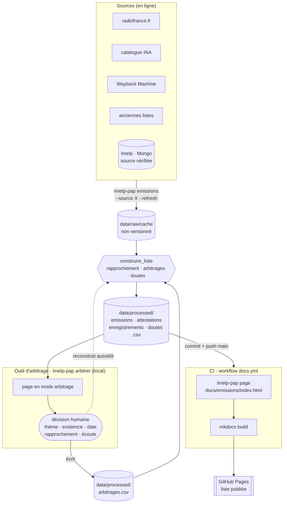

# Architecture : de la collecte à la page publiée

Le projet produit deux livrables, qui partagent une même construction de la liste :

- **la liste publiée** : la page statique des émissions, générée par la CI à partir des CSV de `data/processed/` et publiée sur GitHub Pages ;
- **l'outil d'arbitrage** (`lmelp-pap arbitrer`) : un serveur local qui lève les doutes de la liste par des décisions humaines, enregistrées dans `arbitrages.csv`.

Les données de référence sont les CSV versionnés de `data/processed/` ; la page n'en est qu'une vue.

## Flux



## Étapes

**Collecte.** `lmelp-pap emissions` collecte chaque source dans `data/raw/cache/`. Une source dont la collecte est terminée est relue depuis le cache ; `--refresh` la collecte à nouveau. lmelp n'est accessible que depuis le devcontainer.

**Construction.** `construire_liste` (`src/lmelp_pap/liste.py`) rapproche les attestations des sources, applique les arbitrages de `arbitrages.csv`, fusionne chaque émission champ par champ et détecte ses doutes. `ecrire_liste` (`src/lmelp_pap/ecriture.py`) écrit les CSV liés par l'identifiant de l'émission. La commande `emissions` et l'outil d'arbitrage passent tous deux par cette construction.

**Arbitrage.** `lmelp-pap arbitrer` (`src/lmelp_pap/arbitrer.py`) sert la page de la liste avec ses contrôles d'arbitrage. Chaque décision s'ajoute à `arbitrages.csv` ; la liste est reconstruite depuis le cache, sans réseau, et ses CSV sont réécrits. Un arbitrage s'attache à une attestation, pas à l'identifiant d'une émission : il s'applique de nouveau à chaque construction, y compris après une nouvelle collecte.

**Publication.** Elle suit les CSV : un push sur `main` qui modifie `data/processed/` (ou `docs/`, `src/`) déclenche la workflow `docs.yml`. Elle lance `lmelp-pap page` (`src/lmelp_pap/page.py`), qui génère `docs/emissions/index.html`, une page autonome embarquant les données en JSON, puis construit la documentation MkDocs et la déploie sur GitHub Pages. La page générée n'est pas versionnée (`.gitignore`) ; en local, `lmelp-pap page` sert seulement à la prévisualiser avec `mkdocs serve`.

Cycle type après une séance d'arbitrage ou une nouvelle collecte :

```bash
uv run --active lmelp-pap emissions --source lmelp --refresh   # ou arbitrer
git diff --stat data/processed
git add data/processed && git commit -m "docs(liste): mettre la liste à jour"
git push   # sur main, ou via une PR : la CI régénère et publie la page
```

Le détail des commandes, des fichiers produits et des règles de construction est dans la documentation utilisateur, [Liste des émissions](../user/liste-des-emissions.md).
