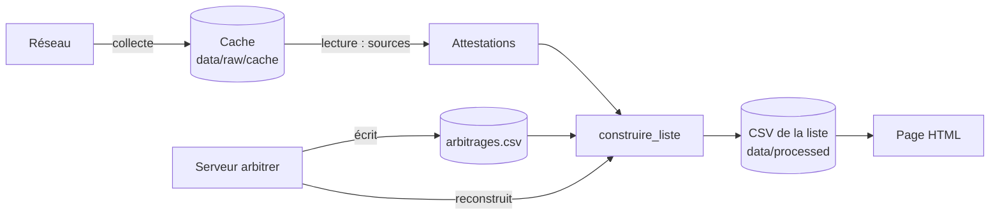

# Référence du code

Cette page documente chaque module, classe et fonction du paquet `lmelp_pap`, fonctions privées (préfixées par `_`) comprises. Elle est générée à partir des docstrings du code par [mkdocstrings](https://mkdocstrings.github.io/) : pour la modifier, modifier les docstrings. Le vocabulaire (émission, attestation, rapprochement, doute, arbitrage…) est celui du glossaire `CONTEXT.md` ; les décisions sont dans `docs/adr/`.

## Vue d'ensemble

| Module | Rôle |
|---|---|
| [`cli`](#lmelp_pap.cli) | La commande `lmelp-pap` et ses sous-commandes `emissions`, `page` et `arbitrer`. |
| [`collecte`](#lmelp_pap.collecte) | Collecte des sources dans le cache (réseau), puis lecture du cache en attestations (sans réseau). |
| [`liste`](#lmelp_pap.liste) | Modèle (attestation, émission, arbitrage, doute) et construction de la liste : rapprochement, fusion, arbitrages, doutes. |
| [`arbitrages`](#lmelp_pap.arbitrages) | Lecture et écriture de `arbitrages.csv`. |
| [`ecriture`](#lmelp_pap.ecriture) | Écriture de la liste en CSV liés par l'identifiant. |
| [`page`](#lmelp_pap.page) | Page HTML autonome de la liste, publiée ou en mode arbitrage. |
| [`arbitrer`](#lmelp_pap.arbitrer) | Serveur local de l'outil d'arbitrage et son API JSON. |
| [`sources`](#lmelp_pap.sources) | Lecture de chaque source, du texte brut aux attestations. |

::: lmelp_pap.cli

::: lmelp_pap.collecte

::: lmelp_pap.liste

::: lmelp_pap.arbitrages

::: lmelp_pap.ecriture

::: lmelp_pap.page

::: lmelp_pap.arbitrer

::: lmelp_pap.sources

::: lmelp_pap.sources.radiofrance

::: lmelp_pap.sources.audio_radiofrance

::: lmelp_pap.sources.ina

::: lmelp_pap.sources.ina_catalogue

::: lmelp_pap.sources.anciennes_listes

::: lmelp_pap.sources.wayback_podcast

::: lmelp_pap.sources.lmelp
